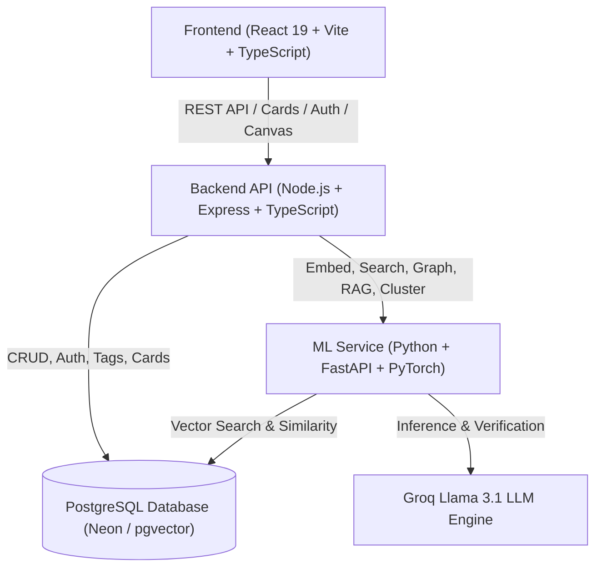

# LinkUp — Intelligent Knowledge Management & Visual Learning Canvas

**LinkUp** is an AI-powered personal knowledge management and visual learning canvas platform. It unifies diverse digital content (PDF documents, DOCX files, web links, social bookmarks, and rich notes), automatically extracts semantic information, organizes notes onto a visual card canvas, and builds a **Knowledge Graph** with vector embeddings. Using an **Agentic Retrieval-Augmented Generation (RAG)** pipeline powered by Groq and sentence transformers, LinkUp enables interactive multi-hop questioning with automatic source citations and hallucination verification.

---

## 📚 Core Documentation Index

This project is organized with comprehensive specifications divided into dedicated documentation files:

1. 📋 **[REQUIREMENTS.md](REQUIREMENTS.md)**: System Requirements Specification (SRS), Functional Requirements, Non-Functional Requirements, Architecture Diagrams, and Technology Matrix.
2. 🗺 **[PHASES.md](PHASES.md)**: **The Complete 6-Phase Master Roadmap**. Contains exhaustive task breakdowns, file-by-file targets, endpoints, and verification checklists for all 6 phases.
3. 🛠 **[IMPLEMENTATION.md](IMPLEMENTATION.md)**: Technical Implementation Guide with full PostgreSQL DDL schema, API contracts, environment configurations, and coding guidelines.

---

## 🏗 High-Level Architecture

---

## ⚡ The 6 Project Phases

The complete system is split into **6 structured phases**:

- **Phase 1: Project Foundation, Database Architecture & Core Auth System**
  - PostgreSQL schema & migrations (`users`, `cards`, `tags`, `card_tags`, `graph_edges`, `migrations`, `pgvector`).
  - Express + TypeScript backend scaffolding & connection pool.
  - JWT Authentication (bcrypt hashing, signup, signin, `/auth/me`).
  - React 19 + Vite frontend shell with dark-mode glassmorphic theme and auth context.

- **Phase 2: Card Management & Multi-Source Content Ingestion Engine**
  - Ingestion extractors: PDF (`pdf-parse`), DOCX (`mammoth`), Web & Social URLs (OpenGraph scraper).
  - Multer upload pipeline & card CRUD APIs.
  - Interactive Canvas UI, Card item components, and multi-source upload modal suite.

- **Phase 3: Python ML Service, Vector Embeddings & Hybrid Search**
  - FastAPI service with `all-MiniLM-L6-v2` dense 384d vector generation.
  - Backend integration hook: auto-vectorizing new cards.
  - Hybrid Search blending PostgreSQL Full-Text Search (FTS) + `pgvector` Cosine Similarity.
  - Frontend search bar with real-time hybrid scoring badges and keyword highlighting.

- **Phase 4: Knowledge Graph Construction & Topological Intelligence**
  - Pairwise cosine similarity thresholding between cards.
  - `graph_edges` persistence and PageRank network centrality computation.
  - Interactive Knowledge Graph visualization canvas with force-directed nodes, zoom, and neighbor exploration.

- **Phase 5: Smart Arrange & Semantic Clustering**
  - Graph community detection (Louvain algorithm / modularity clustering).
  - Groq Llama 3.1 LLM-generated thematic titles for card clusters.
  - Smart Arrange visual view with organized thematic swimlanes.

- **Phase 6: Agentic RAG System, Hallucination Verification & End-to-End Hardening**
  - Multi-hop RAG retrieval combining vector search and 1st-hop graph neighbors.
  - Groq Llama 3.1 grounded prompt synthesis with strict card citations.
  - Automated hallucination self-verification engine producing confidence scores.
  - Conversational AI Chat Assistant UI with interactive citation preview chips.
  - Security hardening (Helmet, rate limiting, input sanitization) and full verification.

---

## 🚀 Getting Started

Refer to [PHASES.md](PHASES.md) for full phase-by-phase implementation instructions and [IMPLEMENTATION.md](IMPLEMENTATION.md) for environment variable configurations and database setup.
